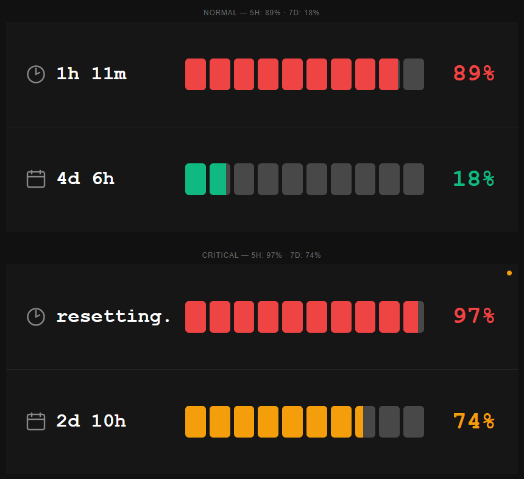
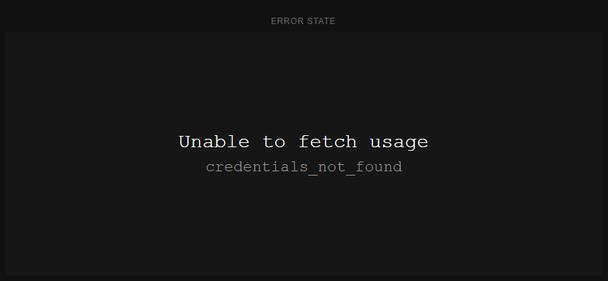

# Claude Usage Widget for XENEON EDGE

A real-time Claude Code token usage display for the **Corsair XENEON EDGE** auxiliary screen.
Two components ship together: a small Windows Service that manages authentication, and an iCUE widget that renders your usage on the display.

## Preview




## What it shows

- **5-hour** and **7-day** usage windows, each rendered as a 10-segment block bar
- Color-coded percentage (green → amber → red) as you approach the limit
- Countdown to the next reset for each window
- A status dot that turns amber when the data is stale (server unreachable but cached)

## Requirements

- Windows 10 / 11
- Corsair XENEON EDGE with **iCUE 5**
- Claude Code installed and signed in (`claude login`)
- .NET 8 Runtime (if not using the self-contained build)

## Install

### Option A — MSI installer (recommended)

1. Run `ClaudeUsageServer.msi` and accept the UAC prompt. The installer copies the service, registers it as a Windows Service, and starts it automatically.
2. In iCUE, go to **Widgets → Import** and select `claudeusage.icuewidget`.
3. Assign the widget to a XENEON EDGE S slot.

That's it. The widget starts showing live usage as soon as the service is running.

### Option B — Manual install

**Register the Windows Event Log source (one-time, run as Administrator):**

```powershell
New-EventLog -Source "ClaudeUsageServer" -LogName Application
```

**Publish the service:**

```powershell
dotnet publish ClaudeUsageServer.csproj -c Release -r win-x64 --self-contained false -o publish\
```

**Register and start the service (run as Administrator):**

```powershell
sc.exe create ClaudeUsageServer `
    binPath= "C:\path\to\publish\ClaudeUsageServer.exe" `
    DisplayName= "Claude Usage Server" `
    start= auto
sc.exe description ClaudeUsageServer "Proxies Claude Code OAuth usage data to the iCUE widget."
sc.exe start ClaudeUsageServer
```

**Import the widget into iCUE:**

Go to **Widgets → Import** and select `widgets/claudeusage.icuewidget`.

**Verify the service is up:**

```powershell
curl http://127.0.0.1:41920/health   # → ok
curl http://127.0.0.1:41920/status   # → {"tokenValid":true,...}
```

## Widget settings

Configurable from the iCUE settings panel — no config files or restarts needed.

| Setting | Default | Description |
|---------|---------|-------------|
| Refresh Interval | 60 s | How often the widget polls the local service |
| Threshold Color Coding | On | Switches block/percentage color from blue to green/amber/red based on utilization |
| Text Color | `#FFFFFF` | Color of the countdown text |
| Block Color | `#3B82F6` | Filled block color (used when threshold coding is off) |
| Empty Block Color | `#484848` | Unfilled block color |
| Percentage Color | `#FFFFFF` | Percentage label color (used when threshold coding is off) |
| Low / Medium / High Color | green / amber / red | Colors used when threshold coding is on |
| Background Color | `#161616` | Widget background |
| Widget Transparency | 0% | Background opacity |

The port (`41920`) is hardcoded and is not a configurable widget property.

---

## How it works

```
~/.claude/.credentials.json
      │  claudeAiOauth.{ accessToken, expiresAt }
      │  read on startup; watched for external changes
      ▼
┌──────────────────────────────────────────┐
│  ClaudeUsageServer  (Windows Service)    │
│  127.0.0.1:41920                         │
│                                          │
│  • Loads token into memory               │
│  • Refreshes token ~5 min before expiry  │
│  • Caches last Anthropic response        │
│                                          │
│  GET /health  → "ok"                     │
│  GET /status  → { tokenValid, expiresAt }│
│  GET /usage   → proxied Anthropic data   │
└──────────────┬───────────────────────────┘
               │  http://localhost:41920/usage
               │  (no credentials in request)
               ▼
┌──────────────────────────────────────────┐
│  ClaudeUsageWidget  (iCUE HTML widget)   │
│  840 × 344 px  ·  XENEON EDGE S-H slot   │
│                                          │
│  • Polls proxy every N seconds           │
│  • Renders block bars + countdown text   │
└──────────────────────────────────────────┘
```

The service is the only component that handles credentials. The widget calls `localhost` and the service injects the bearer token server-side — no token is ever configured in iCUE or visible to the widget.

### Token refresh

On startup the service reads `~/.claude/.credentials.json` and schedules a proactive refresh at `expiresAt − 5 minutes`. At refresh time it runs a minimal Claude CLI call:

```
claude -p "hi" --model haiku --tools "" --no-session-persistence --effort low
```

This causes the Claude CLI to silently renew the OAuth token and write the updated credentials back to disk. The service detects the file change via `FileSystemWatcher` and loads the new token within ~500 ms.

> **Note:** `claude --version` does **not** refresh the OAuth token. Only actual API calls trigger a renewal.

**Cost trade-off:** Each refresh makes a real Haiku API call. This counts against your Claude Code usage limits — one micro-request per ~26 hours. A direct OAuth `refresh_token` grant would avoid this, but that mechanism is not exposed via the Claude Code CLI.

**Retry:** If the CLI call fails, the service logs a warning and retries every 60 s (configurable). If Claude Code or another tool refreshes the token externally, the `FileSystemWatcher` picks it up within ~500 ms.

**Running as LocalSystem:** When installed as a Windows Service the process runs as LocalSystem, which does not inherit your user's `PATH`. You must set `ClaudeCliPath` explicitly in `appsettings.json`:

```json
"ClaudeCliPath": "C:\\Users\\YourName\\AppData\\Roaming\\npm\\claude.cmd"
```

To find the correct path:

```powershell
(Get-Command claude).Source
```

The MSI installer sets this automatically from the installing user's environment. For manual installs, set it before starting the service.

---

## Configuration

All settings live in `appsettings.json` next to the executable.
Every value is also overridable via environment variable using the prefix `ClaudeUsageServer__<Key>`.

| Key | Default | Description |
|-----|---------|-------------|
| `Port` | `41920` | TCP port Kestrel binds on (127.0.0.1 only) |
| `CredentialsPath` | *(empty)* | Path to the credentials JSON. Empty = `%USERPROFILE%\.claude\.credentials.json` |
| `ClaudeCliPath` | *(empty)* | Full path to `claude.cmd`. Empty = auto-derived. **Must be set explicitly when running as LocalSystem.** |
| `RefreshBufferMinutes` | `5` | Minutes before token expiry to trigger a proactive refresh |
| `RetryIntervalSeconds` | `60` | Wait between failed refresh retries |
| `CacheTtlSeconds` | `60` | How long a successful Anthropic response is served from cache |
| `LogRetentionDays` | `14` | Number of daily log files to keep |
| `LogMaxFileSizeMB` | `10` | Max size of a single log file before rolling to a new one |
| `LogMaxTotalSizeMB` | `100` | Safety-net cap on total log directory size |

**Note:** `CredentialsPath` and `ClaudeCliPath` are never written to logs.

---

## Endpoints

| Method | Path | Description |
|--------|------|-------------|
| `GET` | `/health` | Returns `ok`. Used for readiness checks. |
| `GET` | `/status` | Returns `{ tokenValid, expiresAt, lastRefresh }`. No credential data. |
| `GET` | `/usage` | Proxies `https://api.anthropic.com/api/oauth/usage`. Returns usage JSON or a 503 error object. |
| `OPTIONS` | `/usage` | CORS preflight — returns 200 with CORS headers. |

All endpoints are reachable only from `127.0.0.1`.

### Response caching

`/usage` caches the last successful Anthropic response in memory:

1. **Fresh cache hit** (younger than `CacheTtlSeconds`) — returned immediately, no upstream call.
2. **Cache miss** — upstream is called; on success the response is cached and returned.
3. **Anthropic error with stale cache** — stale body returned with `X-Cache-Stale: true` header.
4. **Anthropic error with no cache** — error returned as-is.

### Error responses

| Condition | Status | Body |
|-----------|--------|------|
| Credentials file not found | 503 | `{"error":"credentials_not_found"}` |
| Token expired, refresh pending | 503 | `{"error":"token_expired"}` |
| Anthropic non-200, no cache | same as upstream | upstream body |
| Anthropic error, stale cache | 200 + `X-Cache-Stale: true` | last cached body |
| Network failure, stale cache | 200 + `X-Cache-Stale: true` | last cached body |
| Network failure, no cache | 503 | `{"error":"upstream_unavailable"}` |

---

## Logging

Logs are written to `%ProgramData%\ClaudeUsageServer\logs\` (MSI install) or `logs\` next to the executable (manual install).

- **Rolling file:** one file per day (`claudeusageserver-YYYYMMDD.log`), rolls to a numeric suffix if a single day exceeds `LogMaxFileSizeMB`.
- **Windows Event Log:** Application log, source `ClaudeUsageServer`. Warnings and errors only.
- **Total-size cap:** a background task runs on startup and every 24 hours, deleting oldest files if the directory exceeds `LogMaxTotalSizeMB`.

**What is never logged:** token values, Authorization headers, raw HTTP headers, file contents, or environment variable values.

---

## Build

```powershell
# Service
dotnet publish ClaudeUsageServer.csproj -c Release -r win-x64 --self-contained false -o publish\

# MSI
dotnet build ClaudeUsageServer.Installer\ClaudeUsageServer.Installer.wixproj -c Release -p:Platform=x64

# Or both in one pass
dotnet publish ClaudeUsageServer.csproj -c Release -r win-x64 --self-contained false -o publish\
dotnet build ClaudeUsageServer.sln -c Release -p:Platform=x64
```

The MSI is output to `ClaudeUsageServer.Installer\bin\x64\Release\ClaudeUsageServer.msi`.

For a self-contained single-file executable:

```powershell
dotnet publish -c Release -r win-x64 --self-contained true -p:PublishSingleFile=true -o publish\
```

---

## MSI installer details

### What the installer does

1. Copies all service files to `%ProgramFiles%\ClaudeUsageServer\`.
2. Creates `%ProgramData%\ClaudeUsageServer\logs\` for log files.
3. Registers the Windows Event Log source `ClaudeUsageServer`.
4. Installs the Windows Service (auto-start, LocalSystem account).
5. Writes the installing user's `%USERPROFILE%` and `%APPDATA%` paths into the service's environment registry entry so LocalSystem can find the credentials file and Claude CLI at runtime.
6. Starts the service.

### Uninstall

**Settings → Apps → Claude Usage Server → Uninstall**, or via Add/Remove Programs.

| Action | Detail |
|--------|--------|
| Stop service | Waits for exit before proceeding |
| Delete service | Removes SCM registration |
| Remove files | Deletes `%ProgramFiles%\ClaudeUsageServer\` |
| Remove Event Log source | Deletes the registry key |

`%ProgramData%\ClaudeUsageServer\logs\` is **not** removed. To fully wipe:

```powershell
Remove-Item -Recurse -Force "$env:ProgramData\ClaudeUsageServer"
```

### Upgrade

Install a new MSI over an existing installation. The installer performs a major upgrade (removes old, installs new). The service is stopped before removal and restarted after install.

`appsettings.json` is overwritten on upgrade. Use environment variable overrides to survive upgrades:

```powershell
$svcKey = "HKLM:\SYSTEM\CurrentControlSet\Services\ClaudeUsageServer"
$existing = (Get-ItemProperty $svcKey).Environment
Set-ItemProperty $svcKey -Name Environment -Value (
    @("ClaudeUsageServer__CredentialsPath=C:\Users\You\.claude\.credentials.json") + $existing
)
```

### Troubleshooting

**Service won't start after install**

Check `%ProgramData%\ClaudeUsageServer\logs\`. The most common cause is the installer failing to write user paths into the registry. Verify:

```powershell
Get-ItemProperty "HKLM:\SYSTEM\CurrentControlSet\Services\ClaudeUsageServer" -Name Environment
# Expected:
# ClaudeUsageServer__CredentialsPath=C:\Users\YourName\.claude\.credentials.json
# ClaudeUsageServer__ClaudeCliPath=C:\Users\YourName\AppData\Roaming\npm\claude.cmd
```

To fix manually (run as Administrator):

```powershell
$svcKey = "HKLM:\SYSTEM\CurrentControlSet\Services\ClaudeUsageServer"
Set-ItemProperty $svcKey -Name Environment -Type MultiString -Value @(
    "ClaudeUsageServer__CredentialsPath=$env:USERPROFILE\.claude\.credentials.json",
    "ClaudeUsageServer__ClaudeCliPath=$env:APPDATA\npm\claude.cmd"
)
sc.exe stop ClaudeUsageServer
sc.exe start ClaudeUsageServer
```

**Port 41920 already in use**

Change `Port` in `appsettings.json`, update the widget's hardcoded port reference in `index.html`, and restart the service.

**Claude Code not installed or not authenticated**

The service starts but `/status` returns `tokenValid: false`. Run `claude login`, then restart the service or wait up to ~500 ms for the `FileSystemWatcher` to pick up the new credentials file.
